# Cẩm Nang Thực Hành Lab Day 05: Gán Nhãn Tracking Đa Đối Tượng (MOT) Với CVAT
> **Dành cho:** Học viên khóa K5 - Level 2 Computer Vision  
> **Bộ dữ liệu thực hành:** `MOT17-09` (150 frames, chuẩn 1920×1080 @ 30 FPS)  
> **Thời lượng thực hành:** 240 phút (Checkpoints CP0 – CP4)  
> **Mục tiêu đạt:** 100 điểm Rubric C1–C8, 0 lỗi `id_switch` không giải thích được.

---

## 1. Tổng Quan & Chuẩn Bị Trước Khi Làm Bài

### 1.1 Mục Tiêu Bài Lab
Trong bài thực hành này, bạn sẽ đóng vai trò chuyên viên gán nhãn dữ liệu xe tự hành / giám sát an ninh (Annotation Specialist):
1. Theo vết liên tục (Multi-Object Tracking) **đúng 5 đối tượng người đi bộ** được phân công theo MSSV xuyên suốt 150 frame của chuỗi `MOT17-09`.
2. Sử dụng chế độ **Track** (tuyệt đối không dùng *Shape*) kết hợp nội suy tuyến tính (Linear Interpolation) để tối ưu công sức gán nhãn (đạt 8–18 keyframe / 100 frame).
3. Xử lý chính xác các trường hợp **che khuất (occlusion)** bằng thuộc tính `occluded` (`Q`) và biến mất tạm thời bằng `outside` (`O`), giữ vẹn nguyên ID (không bị `id_switch`).
4. Xuất file theo chuẩn **MOT 1.1** và **CVAT for video 1.1**, chạy kiểm tra tự động bằng `check_submission.py` và hoàn thành báo cáo cá nhân.

---

### 1.2 Quy Tắc Đặt Tên Repository & File Nộp
- **Tên Repository GitHub:** `K5-L2-DAY05-HoVaTen-MSSV-MOTTracking`  
  *(Ví dụ: `K5-L2-DAY05-NguyenVanA-20241231-MOTTracking`)*
- **File báo cáo cá nhân:** `report/individual/MSSV_HoTen.md`  
  *(Ví dụ: `report/individual/20241231_NguyenVanA.md`)*
- **3 ảnh chụp minh chứng che khuất:**
  - `report/individual/che_1_truoc.png`
  - `report/individual/che_2_giua.png`
  - `report/individual/che_3_sau.png`
- **File dữ liệu xuất (Export):**
  - `src/exports/HoVaTen_mot.zip`
  - `src/exports/HoVaTen_cvat_video.zip`

---

### 1.3 Phân Phối Đề & 5 Đối Tượng Cần Theo Vết
Mỗi học viên được phân công 1 trong 3 đề (A, B, C) dựa vào 8 chữ số Mã Số Sinh Viên (MSSV):
$$\text{hash} = \text{SHA256}(\text{MSSV}) \pmod 3$$

| Đề | Danh sách ID gốc trong MOT17-09 | Đối tượng bài test che khuất CP2 |
| :---: | :---: | :---: |
| **Đề A** | `[1, 7, 19, 20, 21]` | Person 1 (bị Person 2 che) |
| **Đề B** | `[1, 2, 7, 14, 20]` | Person 1 (bị Person 2 che) |
| **Đề C** | `[1, 7, 12, 19, 20]` | Person 1 (bị Person 2 che) |

> [!IMPORTANT]
> Cả 3 đề đều có **Person 1** đi qua cửa hàng Vodafone và bị **Person 2** che khuất hoàn toàn trong một khoảng thời gian ngắn (khoảng 7 frame). Đây là bài test bắt buộc của Checkpoint CP2!

Để xác định đề và tạo ảnh hướng dẫn nhận diện 5 người đi bộ, bạn chạy lệnh:
```powershell
python src/setup_local_lab.py --mssv <MSSV_CỦA_BẠN> --prepare-only
```
Sau khi chạy, file ảnh nhận diện sẽ được lưu tại `.lab-local/de-<A|B|C>-P1-P5.jpg`:

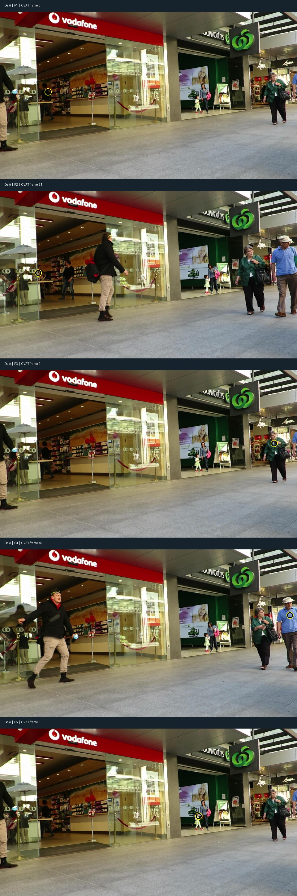
*Hình 1: Ảnh nhận diện 5 người đi bộ Đề A (P1: áo len đen trong shop Vodafone, P2: áo khoác đen quần kaki, P3: áo xanh kẻ, P4: áo xanh lam, P5: bé gái áo trắng).*

---

## 2. Bước 1: Khởi Tạo Task CVAT & Cấu Hình Workspace (CP0: 5′ – 45′)

### 2.1 Khởi Động Docker & Tạo Task Tự Động
1. Đảm bảo ứng dụng **Docker Desktop** trên máy tính đã bật và biểu tượng Docker hiển thị màu xanh (Running).
2. Chạy lệnh tự động tạo task trên CVAT local:
```powershell
python src/setup_local_lab.py --mssv <MSSV_CỦA_BẠN>
```
3. Mở trình duyệt web truy cập: [http://localhost:8080](http://localhost:8080) và đăng nhập bằng tài khoản CVAT của bạn.
4. Bạn sẽ thấy Task mới có tên dạng `DAY05-MOT17-09-<ĐỀ>-<MSSV>` đã được tạo sẵn kèm 1 Job gồm 150 frames:

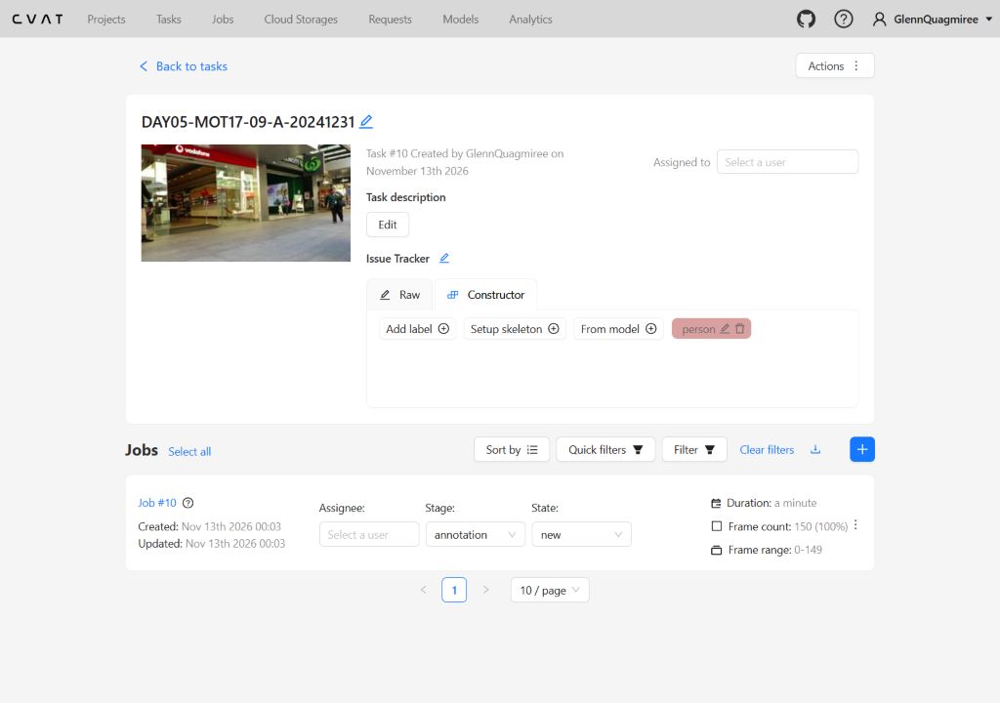
*Hình 2: Task DAY05-MOT17-09-A-20241231 đã sẵn sàng với nhãn `person` và Job #10 (150 frames).*

---

### 2.2 Cấu Hình Tối Ưu Cho Workspace & Player (Bắt Buộc)
Nhấp chuột vào dòng **Job #...** để mở không gian gán nhãn. Trước khi vẽ, bạn cần cấu hình các thông số sau:

1. **Player Settings:**
   - Nhấp vào biểu tượng bánh răng ⚙️ (Settings) ở góc trên bên phải -> Chọn tab **Player**.
   - Mục **Player step**: Đổi thành `10` (mặc định là 10). Giá trị này cho phép bạn dùng phím tắt `V` (nhảy tiến 10 frame) và `C` (nhảy lùi 10 frame) để gán nhãn cực nhanh.

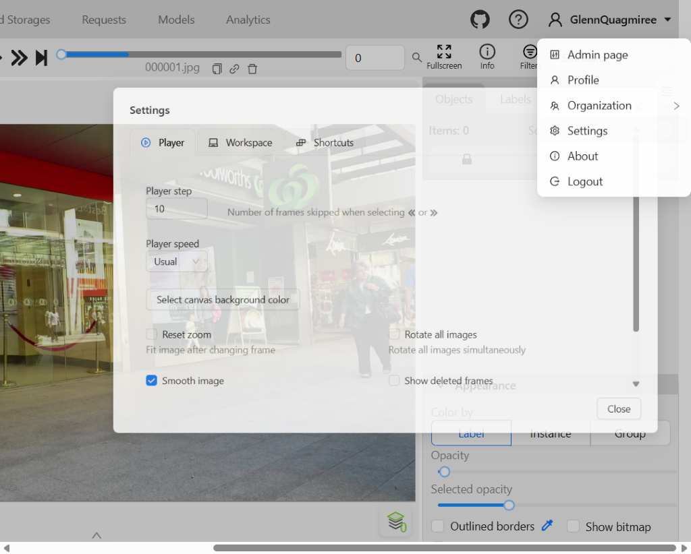
*Hình 3: Thiết lập Player step = 10 để nhảy nhanh qua các khoảng cách nội suy.*

2. **Workspace Settings:**
   - Chọn tab **Workspace**.
   - Bật **Enable auto save** (đặt chu kỳ `15 minutes`) để tránh rủi ro mất dữ liệu khi trình duyệt gặp sự cố.
   - Bật **Always show object details** để luôn hiển thị tên nhãn, Track ID và kích thước bounding box trên màn hình.

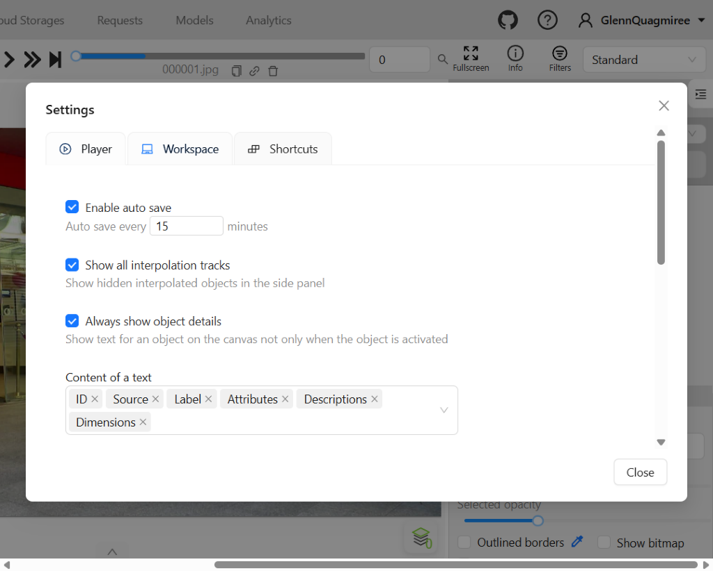
*Hình 4: Kích hoạt Auto save và Always show object details.*

3. **Bật Đường Gióng (Projections):**
   - Ở cột công cụ bên phải, cuộn xuống bảng **Appearance**.
   - Đánh dấu chọn ô **Show projections**. Hai đường gióng vuông góc màu xanh sẽ xuất hiện theo con trỏ chuột, giúp bạn căn chỉnh đáy bounding box khớp chính xác với bàn chân người đi bộ.

---

### 2.3 Thao Tác Vẽ Thử Nghiệm Track (Demo Track)
> [!CAUTION]
> **Quy tắc sinh tử:** Trong suốt bài Lab, khi vẽ bounding box bạn **BẮT BUỘC** chọn chế độ **Track** (tuyệt đối không chọn *Shape*). Chế độ Shape sẽ biến mỗi frame thành một đối tượng độc lập, làm mất tính liên tục của chuỗi tracking và bạn sẽ nhận điểm 0 ở tiêu chí IDF1!

1. Nhấn phím `N` (hoặc nhấp công cụ *Draw new rectangle* ở thanh công cụ bên trái).
2. Chọn nhãn `person`, chọn nút **Track**.
3. Kéo thả 2 điểm để vẽ 1 hộp bao trọn thân người đi bộ tại frame 0.
4. Nhấn phím `V` để nhảy đến frame 10. Kéo dời hộp bao theo vị trí người đó ở frame 10.
5. CVAT sẽ tự động nối các frame từ 1 đến 9 bằng đường nội suy tuyến tính (Linear Interpolation).

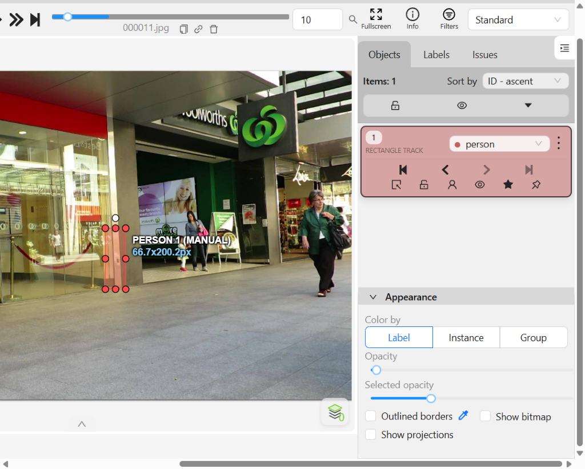
*Hình 5: Vẽ thử Track mẫu - thanh Objects bên phải hiển thị `RECTANGLE TRACK person`.*

6. Sau khi hiểu rõ thao tác, chọn track thử nghiệm này và nhấn `Delete` (hoặc chọn thùng rác) để xóa đi, trả lại không gian sạch sẽ chuẩn bị cho bài làm chính thức.

---

## 3. Bước 2: Quy Trình Gán Nhãn Tracking Tuyến Tính (CP1: 45′ – 100′)

### 3.1 Chiến Thuật "One Person at a Time" (Theo Từng Người Một)
- **ĐỪNG BAO GIỜ** gán nhãn cả 5 người trên cùng 1 frame rồi mới nhảy sang frame tiếp theo. Bạn sẽ rất dễ nhầm lẫn vị trí và bỏ quên keyframe.
- **HÃY LÀM THEO CÁCH:** Chọn Person 1 -> Theo vết xuyên suốt từ frame đầu tiên đến frame 149 -> Lưu lại (`Ctrl + S`) -> Chuyển sang Person 2.

### 3.2 Quy Chuẩn Bounding Box Amodal
- **Amodal Bounding Box:** Bọc trọn vẹn toàn bộ cơ thể người (từ đỉnh đầu, ba lô, cánh tay đến gót chân).
- Kể cả khi người đi bộ bị bàn ghế, biển quảng cáo hoặc người khác che khuất một nửa thân dưới, bạn vẫn phải ước lượng kéo đáy hộp chạm đất nơi chân người đó đang đứng.

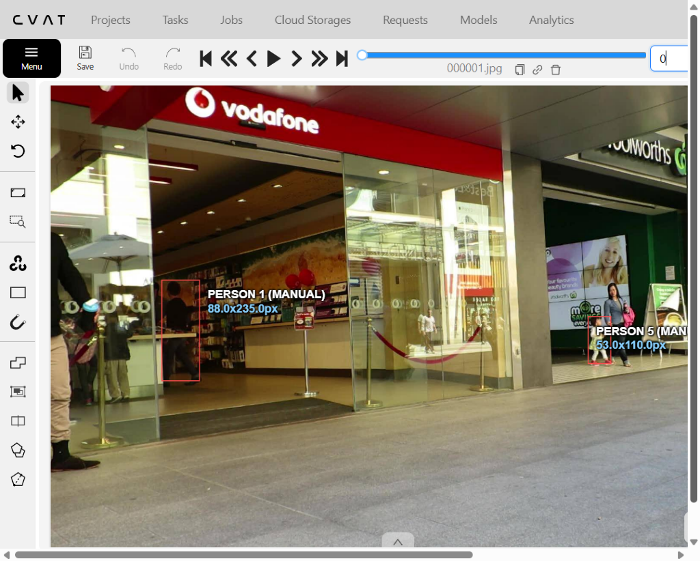
*Hình 6: Frame 0 (000001.jpg) sau khi xác định đúng 5 đối tượng theo phân công Đề A.*

### 3.3 Mật Độ Keyframe Chuẩn (8 – 18 KF / 100 Frames)
- Không phải frame nào cũng cắm keyframe! Trung bình mỗi đối tượng đi thẳng đều chỉ cần cắm 1 keyframe sau mỗi 10–15 frame (dùng phím `V`).
- Chỉ cắm thêm keyframe dày hơn (2–5 frame) khi người đi bộ quay đầu, đổi hướng đột ngột hoặc bước đi nhanh chậm bất thường.

---

## 4. Bước 3: Xử Lý Che Khuất & Phòng Ngừa Lỗi ID Switch (CP2: 115′ – 140′)

Tình huống kinh điển của bài Lab là **Person 1** (người đàn ông áo len đen bên trong shop Vodafone) bị **Person 2** (chàng trai áo khoác đen quần kaki) đi ngang qua che khuất. Bạn cần thực hiện chuẩn xác 4 trạng thái sau:

### Giai Đoạn 1: Trước Khi Bị Che Khuất (Ví dụ: Frame 20)
- Person 1 đang bước đi tự do, chưa bị chướng ngại vật chắn.
- Trạng thái: Bounding box bình thường, thuộc tính `occluded = False`, `outside = False`.
- Chụp ảnh màn hình lưu thành: `report/individual/che_1_truoc.png`.

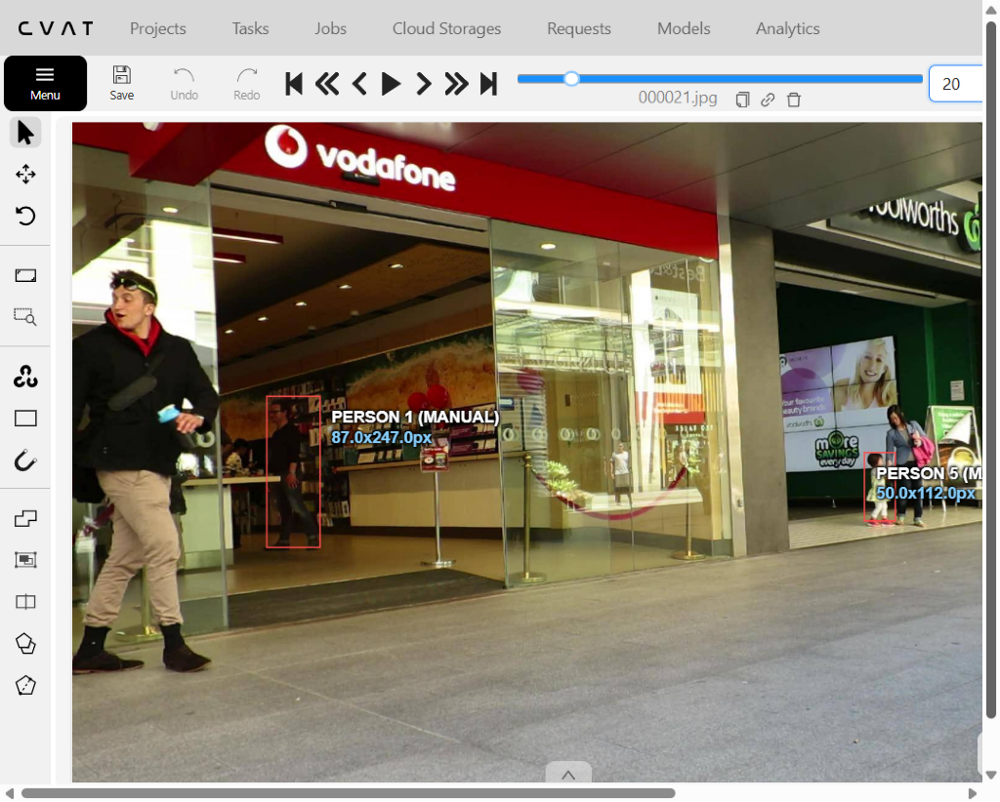
*Hình 7: Frame 20 - Person 1 (Track 1) đi bên trong cửa hàng, Person 2 bắt đầu tiến tới từ phía bên trái.*

---

### Giai Đoạn 2: Che Khuất Một Phần - Bật Occluded (Frame 29 – 38, Tiêu biểu Frame 32)
- Person 2 bắt đầu chắn trước mặt Person 1. Bạn vẫn nhìn thấy một phần đầu hoặc thân của Person 1.
- **Thao tác:** Nhấn phím `Q` (hoặc nhấp chuột vào biểu tượng con mắt/ổ khóa thuộc tính `occluded` trên thẻ đối tượng).
- **Hiện tượng:** Viền bounding box của Person 1 chuyển sang dạng nét đứt.
- **Lưu ý:** Bạn vẫn phải kéo hộp bao toàn thân (Amodal box) ước tính vị trí Person 1 phía sau.
- Chụp ảnh màn hình lưu thành: `report/individual/che_2_giua.png`.

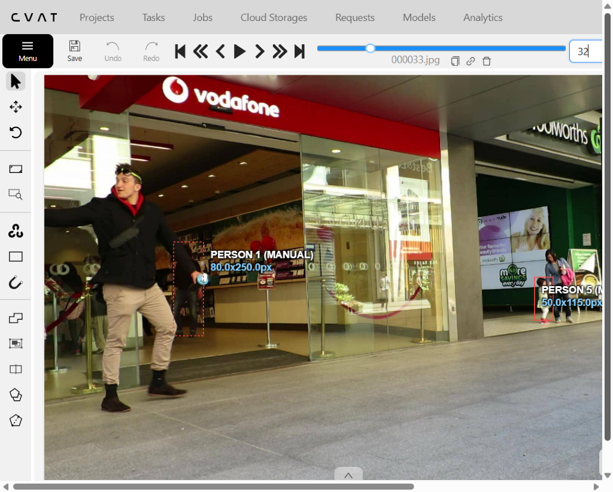
*Hình 8: Frame 32 - Person 1 bị Person 2 che khuất một phần; cờ `occluded` (Q) được bật, viền hộp đứt nét thể hiện amodal box.*

---

### Giai Đoạn 3: Che Khuất Hoàn Toàn - Bật Outside (Frame 39 – 45, Tiêu biểu Frame 42)
- Person 1 bị lưng của Person 2 che lấp 100%, không còn nhìn thấy bất kỳ điểm ảnh nào của Person 1 trong khoảng 7 frame (tương đương 0.23 giây).
- **Thao tác:** Nhấn phím `O` (thuộc tính `outside`).
- **Hiện tượng:** Bounding box của Person 1 tạm thời biến mất khỏi canvas. Khi xuất file MOT 1.1, hệ thống sẽ tự động không ghi dòng dữ liệu cho đối tượng này ở các frame bị outside.

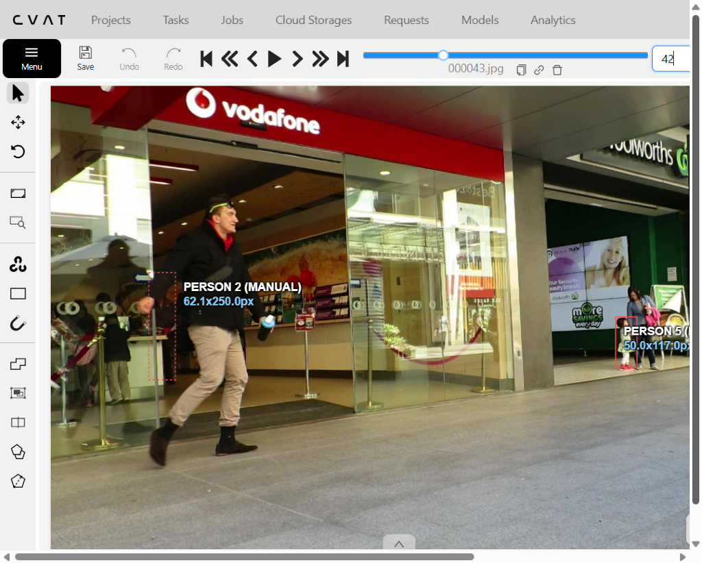
*Hình 9: Frame 42 - Person 1 bị che hoàn toàn (outside = True), hộp bao ẩn đi nhường chỗ cho Person 2 di chuyển.*

---

### Giai Đoạn 4: Tái Xuất Hiện - Tắt Outside, GIỮ NGUYÊN TRACK ID (Frame 46 – 60, Tiêu biểu Frame 60)
> [!WARNING]
> **CẢNH BÁO LỖI ID SWITCH (TRỪ ĐIỂM NẶNG):**  
> Khi Person 1 bước lộ diện trở lại, **tuyệt đối KHÔNG ĐƯỢC nhấn phím `N` để vẽ một track mới!**  
> Thay vào đó, bạn vẫn chọn chính **Track 1 cũ**, tại frame người đó xuất hiện lại (ví dụ frame 46), tắt thuộc tính `outside` (bằng cách nhấn phím `O` hoặc di chuyển lại hộp). Person 1 sẽ tiếp tục hành trình với đúng mã số định danh ban đầu.

- Chụp ảnh màn hình lưu thành: `report/individual/che_3_sau.png`.

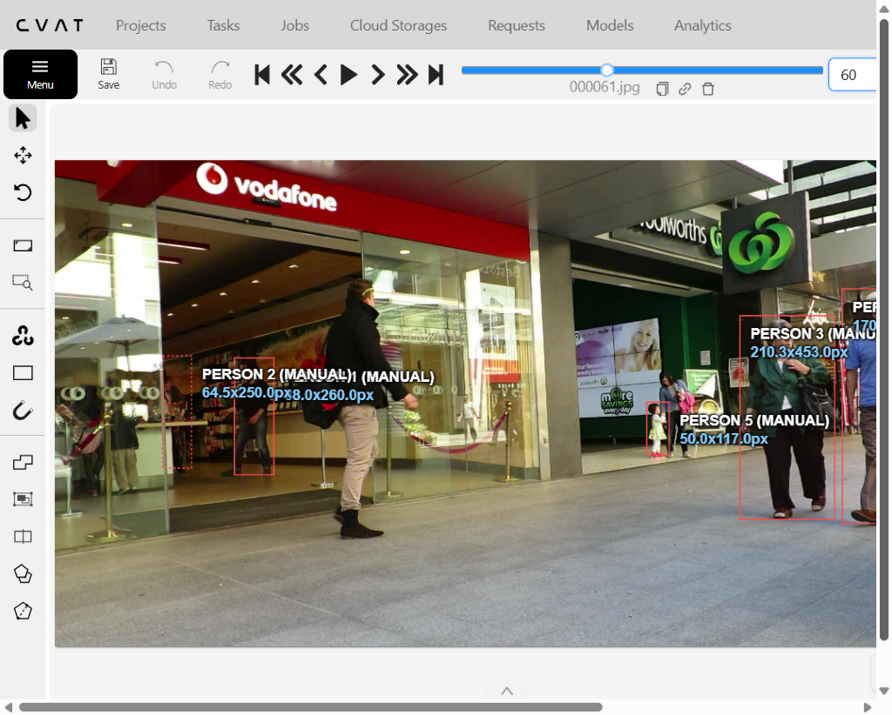
*Hình 10: Frame 60 - Person 1 tái xuất hiện phía sau cánh cửa kính và vẫn giữ nguyên định danh Track ID 1.*

---

## 5. Bước 4: Kiểm Soát Chất Lượng & Rà Soát Hai Lượt (CP3: 140′ – 170′)

Sau khi đã hoàn thành cả 5 đối tượng, bạn cần thực hiện quy trình **2-Pass Review** để quét sạch các lỗi trôi hộp:

1. **Lượt 1: Tua ngược (Reverse Review)**
   - Đưa con trỏ về frame 149.
   - Nhấn `Shift + Space` (hoặc dùng phím `D`/`F`) để phát video chạy lùi từ cuối về đầu.
   - Mắt người nhận diện lỗi trôi hộp (drift) khi xem video chạy ngược nhạy hơn gấp 3 lần so với xem xuôi. Nếu phát hiện chỗ nào hộp bị lệch $\text{IoU} < 0.7$, hãy dừng lại chèn thêm 1 keyframe để nắn chỉnh.

2. **Lượt 2: Xem toàn cảnh (Scene Review)**
   - Phát video với tốc độ 1.0x từ frame 0 đến 149.
   - Đảm bảo các đối tượng đi ra khỏi màn hình (như Person 4 hay Person 5) được đóng track đúng lúc bằng thuộc tính `outside`.

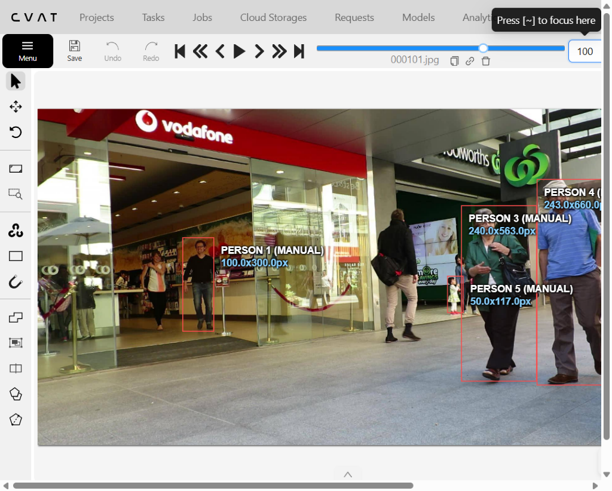
*Hình 11: Frame 100 - Rà soát độ khít của các hộp bao ở giữa đoạn video.*

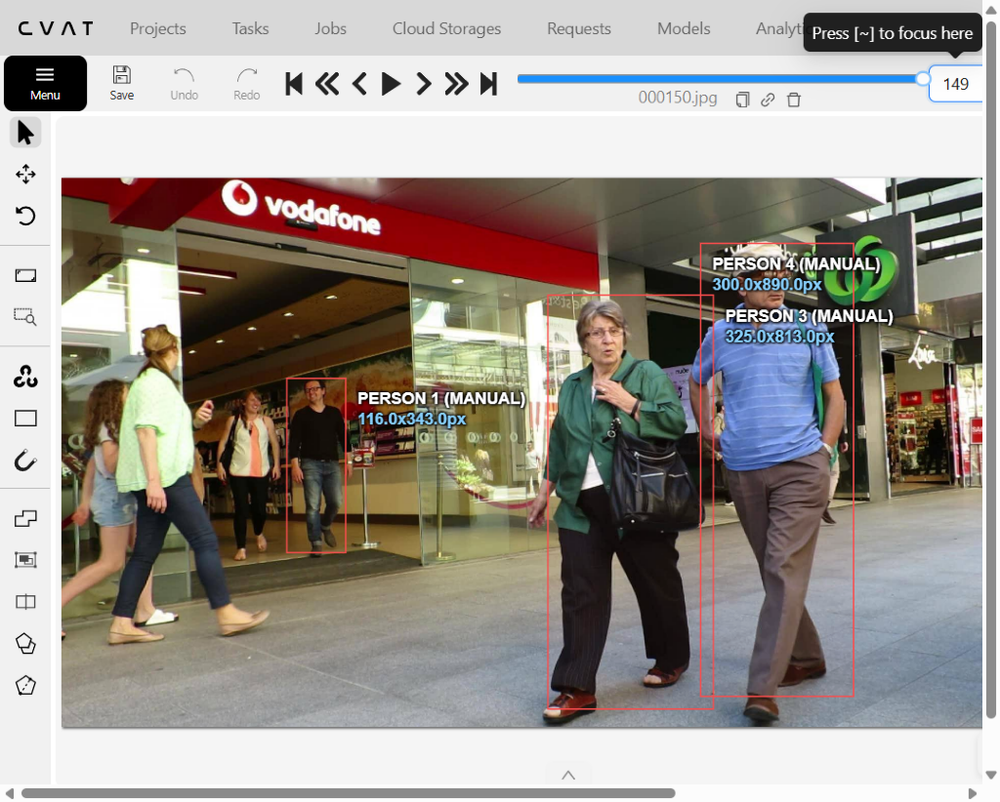
*Hình 12: Frame 149 - Rà soát frame kết thúc, các track kết thúc mượt mà không bị sót frame thừa.*

---

## 6. Bước 5: Xuất Dữ Liệu & Chạy Kiểm Tra Nộp Bài (CP4: 170′ – 195′)

### 6.1 Xuất File Dữ Liệu Từ CVAT
Bạn cần xuất 2 định dạng file khác nhau:

#### 1. Xuất file MOT 1.1:
- Nhấp nút **Menu** ở góc trên bên trái màn hình gán nhãn -> Chọn **Export job dataset**.
- Chọn định dạng: **`MOT 1.1`**.
- **BẮT BUỘC:** Đảm bảo công tắc **`Save images`** đang ở trạng thái **TẮT (UNCHECKED)**. Nộp kèm ảnh sẽ khiến dung lượng repo vượt quá giới hạn và bị trừ điểm vi phạm bản quyền dữ liệu MOT17!
- Nhấn **OK** để tải file zip về máy.

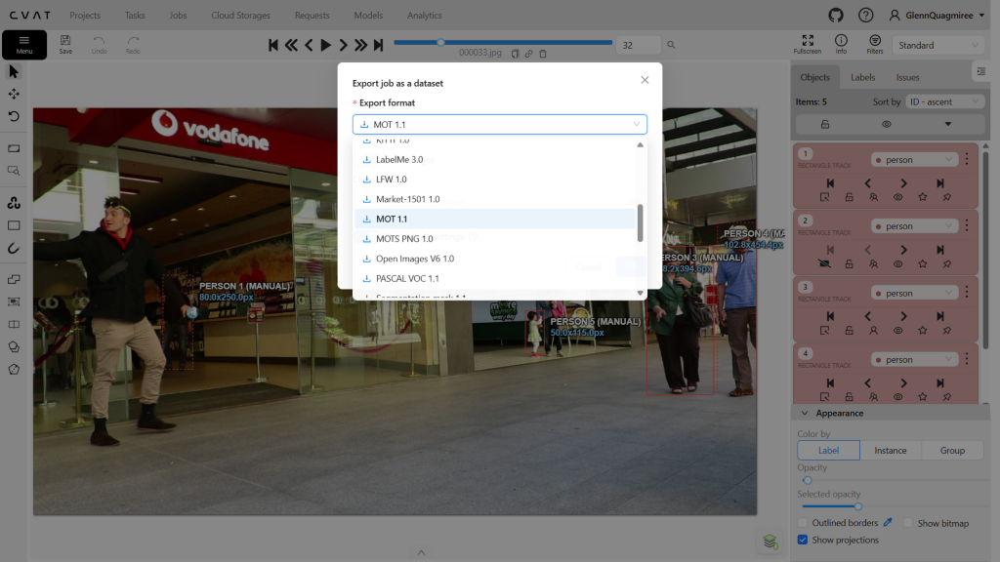
*Hình 13: Xuất định dạng MOT 1.1 với tùy chọn Save images đã tắt.*

#### 2. Xuất file CVAT for video 1.1:
- Nhấp nút **Menu** -> Chọn **Export job dataset**.
- Chọn định dạng: **`CVAT for video 1.1`**.
- Đảm bảo **`Save images`** đang **TẮT**.
- Nhấn **OK** để tải về file zip thứ hai.

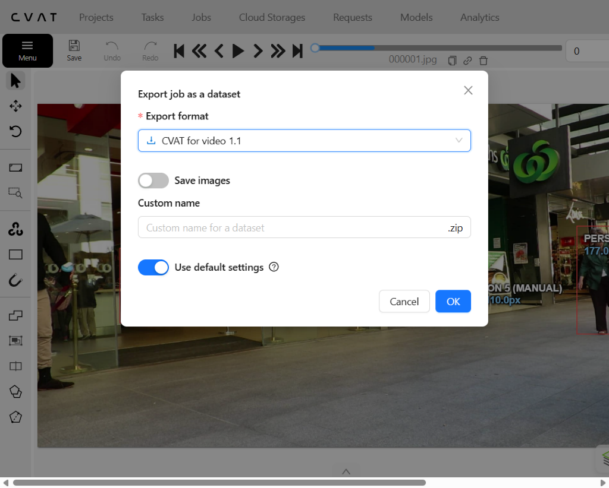
*Hình 14: Xuất định dạng CVAT for video 1.1 (chứa annotations.xml lưu thông tin keyframes và occluded).*

#### 3. Chuyển Trạng Thái Job Sang Completed:
- Trong menu Job, chọn **Finish the job** để hệ thống lưu toàn bộ thay đổi và chuyển trạng thái công việc sang `completed`.

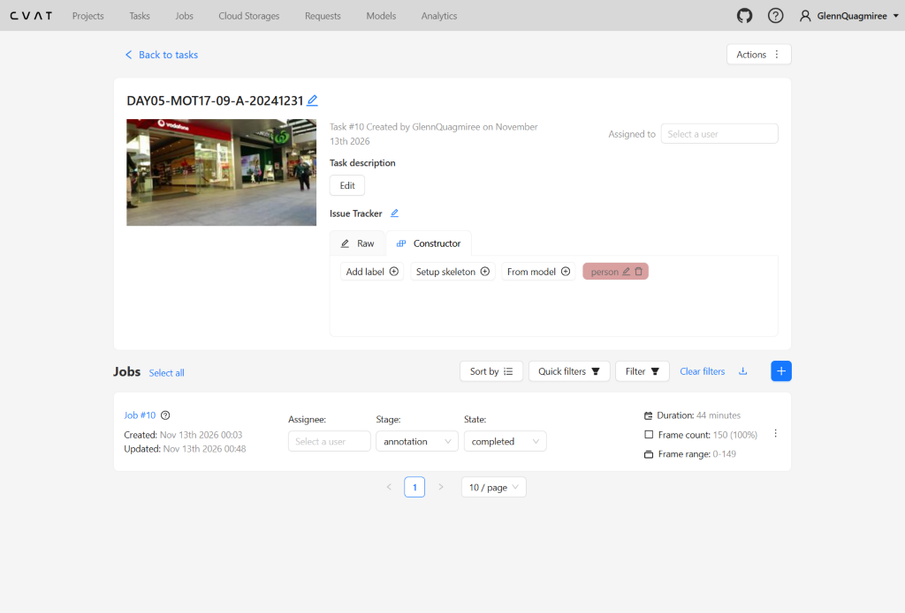
*Hình 15: Job #10 đã được chuyển sang trạng thái completed.*

---

### 6.2 Đổi Tên File & Lưu Vào Thư Mục Nộp Bài
Chuyển 2 file vừa tải về vào thư mục `src/exports/` của repository và đổi tên theo định dạng `HoVaTen_mot.zip` và `HoVaTen_cvat_video.zip`:
```powershell
# Ví dụ đối với học viên Nguyễn Văn A:
src/exports/NguyenVanA_mot.zip
src/exports/NguyenVanA_cvat_video.zip
```

---

### 6.3 Chạy Script Tự Động Kiểm Tra (check_submission.py)
Chạy script thẩm định chất lượng bài làm trước khi viết báo cáo:
```powershell
python src/check_submission.py --mot src/exports/NguyenVanA_mot.zip --cvat src/exports/NguyenVanA_cvat_video.zip --expected 5
```

Khi chạy thành công, màn hình sẽ hiển thị kết quả kiểm định chi tiết:
```text
Số frame in theo CVAT (bắt đầu từ 0). Trong gt.txt, frame_id = frame CVAT + 1.

=== File MOT 1.1: NguyenVanA_mot.zip ===
  Số track ID: 5   |   Tổng số box: 593
  [OK]        Đúng 5 track ID.

  Track | Frame có mặt | Số frame | Đoạn vắng (outside)
      1 |   0–149      |      143 | 39–45
      2 |   0–149      |      150 | -
      3 |   0–149      |      150 | -
      4 |   0–146      |      126 | 114–134
      5 |  41–64       |       24 | -

=== File CVAT for video 1.1: NguyenVanA_cvat_video.zip ===

  Track | Nhãn   | Frame thấy | Keyframe | KF/100 frame | Frame occluded | Lần bật outside
      0 | person |        143 |       12 |          8.4 |             18 |               1
      1 | person |         24 |        4 |         16.7 |             24 |               1
      2 | person |        150 |        9 |          6.0 |              0 |               0
      3 | person |        150 |        9 |          6.0 |             40 |               0
      4 | person |        126 |        8 |          6.3 |             10 |               2

  Tổng: 42 keyframe / 593 frame có mặt = 7.1 keyframe / 100 frame
  [OK]        Đọc được 5 track từ annotations.xml.

=== Tóm tắt ===
  Lỗi: 0   |   Cảnh báo: 0
  Đạt. Dán phần tóm tắt này vào báo cáo mục 5.
```

> [!TIP]
> Hãy sao chép toàn bộ khối văn bản kết quả tóm tắt trên để dán vào **Mục 5: Kết quả check_submission.py** trong file báo cáo cá nhân!

---

## 7. Bước 6: Hoàn Thiện Báo Cáo & Quy Tắc An Toàn Git

### 7.1 Cấu Trúc File Báo Cáo `report/individual/MSSV_HoTen.md`
Mở file mẫu tại `report/individual/MSSV_HoTen.md` và đổi tên thành mã số và họ tên của bạn (ví dụ: `20241231_NguyenVanA.md`). Hoàn thành 7 mục chính:
1. **Thông tin chung:** Họ tên, MSSV, Đề (A/B/C), Danh sách 5 đối tượng.
2. **Bảng phân tích Keyframe:** Thống kê số lượng keyframe đã đặt cho từng đối tượng và giải thích lý do cắm thêm keyframe ở các khúc ngoặt.
3. **Bảng xử lý che khuất (CP2):** Mô tả chi tiết frame bắt đầu bị che, frame bị che hoàn toàn (outside), frame tái xuất hiện và nhúng 3 ảnh minh chứng:
   - ``
   - ``
   - ``
4. **Phân tích lỗi & Thách thức:** Chia sẻ các khó khăn khi gán nhãn (ví dụ: phản chiếu qua cửa kính, người đi quá sát nhau).
5. **Kết quả kiểm tra:** Dán log của `check_submission.py`.
6. **Đánh giá đạo đức (AI Ethics):** Phân tích vấn đề quyền riêng tư khi thu thập hình ảnh nơi công cộng và thiên kiến dữ liệu (bias) trong bài toán tracking người.

---

### 7.2 Kiểm Tra An Toàn Git (Bắt Buộc Trước Khi Git Push)
> [!CAUTION]
> **QUY TẮC CẤM:** Nghiêm cấm commit các file ảnh gốc của bộ MOT17 (`img1/`), file video (`*.mp4`), file dữ liệu xuất `.zip`, mật khẩu hoặc file môi trường `.env` vào Git repo. Nếu vi phạm, bài nộp sẽ bị phạt trừ điểm rất nặng theo quy chế thi.

Trước khi thực hiện `git push`, bạn **BẮT BUỘC** mở terminal và chạy lệnh kiểm tra:

- Trên Linux / macOS / Git Bash:
```bash
git ls-files | grep -E '\.(jpg|jpeg|png|mp4|zip)$'
```
- Trên Windows PowerShell:
```powershell
git ls-files | Select-String -Pattern '\.(jpg|jpeg|png|mp4|zip)$'
```

**KẾT QUẢ ĐẠT CHUẨN:**
Đầu ra của lệnh trên **CHỈ ĐƯỢC CHỨA ĐÚNG 3 FILE** sau:
```text
report/individual/che_1_truoc.png
report/individual/che_2_giua.png
report/individual/che_3_sau.png
```
Nếu phát hiện thấy file `.zip`, thư mục `img1/`, hoặc ảnh không liên quan xuất hiện trong danh sách:
- Chạy lệnh hủy theo dõi ngay lập tức:
```bash
git rm --cached <tên_file_bị_lọt>
```
- Kiểm tra lại file `.gitignore` để đảm bảo đã loại trừ các định dạng này.

---

## 8. Bảng Tổng Hợp Phím Tắt CVAT Thường Dùng

| Phím tắt | Chức năng | Áp dụng trong bài Lab |
| :---: | :--- | :--- |
| `N` | Bắt đầu vẽ đối tượng mới | Nhấn `N`, chọn `person` và chế độ **Track** |
| `Space` | Play / Pause video | Phát hoặc tạm dừng để quan sát chuyển động |
| `F` | Tiến 1 frame | Di chuyển tỉ mỉ từng khung hình |
| `D` | Lùi 1 frame | Lùi lại 1 khung hình |
| `V` | Tiến 1 bước (Player Step = 10) | Nhảy nhanh 10 frame để gán keyframe tiếp theo |
| `C` | Lùi 1 bước (Player Step = 10) | Lùi nhanh 10 frame |
| `Q` | Bật/tắt thuộc tính `occluded` | Đánh dấu người bị che khuất một phần (viền đứt) |
| `O` | Bật/tắt thuộc tính `outside` | Đánh dấu người biến mất hoàn toàn khỏi tầm nhìn |
| `K` | Đặt / Hủy Keyframe thủ công | Cố định hình dạng hộp tại frame hiện tại |
| `Ctrl + S` | Lưu tiến độ (Save) | Lưu dữ liệu gán nhãn lên máy chủ |
| `Delete` | Xóa đối tượng đang chọn | Xóa track lỗi hoặc track vẽ thử |

Chúc bạn thực hiện bài Lab Day 05 đạt kết quả xuất sắc!
