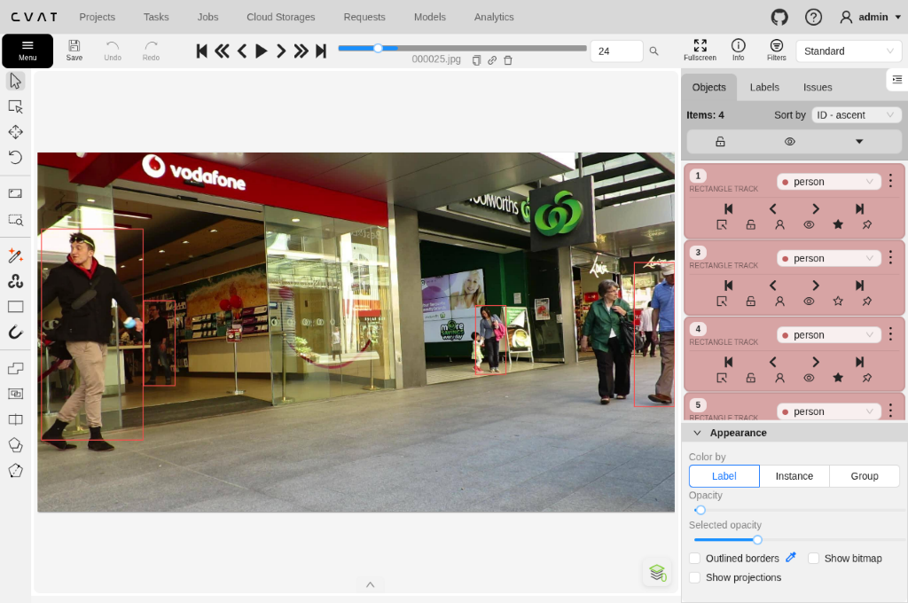
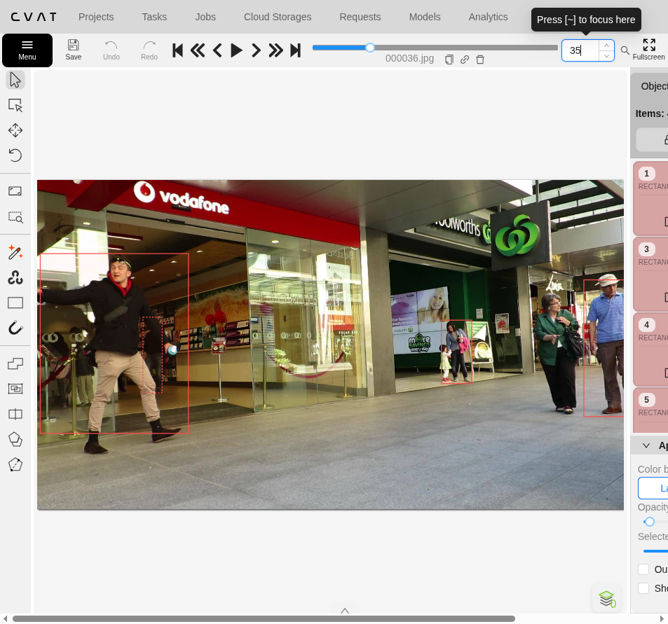
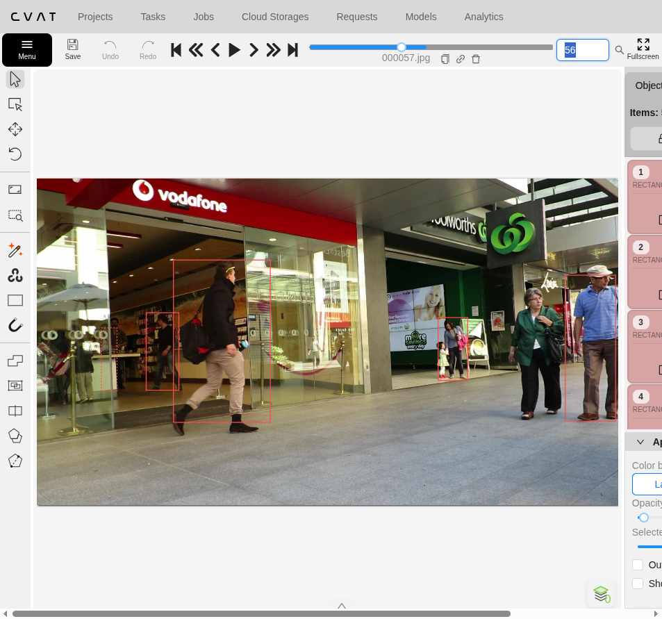

# Báo cáo cá nhân — VuVanThang-2A202603239

Đoạn video: MOT17-09, 150 frame (frame 1–150, CVAT frame 0–149), nguồn MOT17, MOTChallenge (Milan et al., 2016), giấy phép CC BY-NC-SA 3.0.

## 0. Thông tin học viên

- Họ tên: Vũ Văn Thắng (`VuVanThang`)
- MSSV: `2A202603239`
- Mã đề (A/B/C): `C` (`DAY05-MOT17-09-C-2A202603239` — mục tiêu `P1–P5`: ID `[1, 7, 20, 22, 23]` theo `src/lab_variants.json`)
- Email: `Yusei1708@users.noreply.github.com`
- Link repository: https://github.com/Yusei1708/K5-L2-DAY05-VuVanThang-2A202603239-MOTTracking
- Giờ bắt đầu: 16:50 (GMT+7, 2026-11-13)
- Giờ kết thúc: 17:55 (GMT+7, 2026-11-13)

## 1. Xem trước đoạn video (CP0)

Ghi **trước khi vẽ**, mỗi người một dòng.

| Mã | Frame xuất hiện | Frame cuối thấy được | Rẽ / dừng / đổi tốc độ ở frame | Bị che ở frame | Ghi chú |
|---|---|---|---|---|---|
| P1 | 0 (đã ở trong khung từ đầu) | 149 | `f=0–30`: đi chậm sang phải; `f=50–85`: giảm tốc / đứng gần quầy; `f=85–149`: bước chậm về trước-phải | `f=31–39` & `f=44–49` (một phần bởi P5); `f=40–43` (che hoàn toàn 4 frame) | Giữ cùng Track ID qua lần che `f=40–43` (`outside`); không nhầm với người đứng cố định sau cột kính `x≈255–295` |
| P2 | 55 (ló qua kính bên phải cột; rõ hẳn qua mép cột `x=248` ở `f=59`) | 149 | `f=55–90`: đi sang phải qua khe cửa; `f=90–118`: giảm tốc, giơ tay chỉnh cổ áo; `f=120–149`: bước thẳng về trước-phải | `f=55–59` (một phần bởi bảng trắng dưới & cột cửa kính; từ `f=60` thấy rõ) | Giữ box amodal đủ tới chân (`y≈705`) ở `f=55–59` để chiều cao mượt không nhảy bậc |
| P3 | 0 (tay áo phải ló mép phải `x≈1882–1920`; trọn người từ `f=14–20`) | 149 | `f=0–25`: bước vào mép phải; `f=25–44`: đi chậm ngang; `f=44–149`: tiến nhanh sang trái & lại gần camera (chiều cao tăng gấp đôi) | Không (luôn đi ở tiền cảnh phải cùng người áo xanh lá) | Cần nhiều keyframe hơn ở nửa sau vì biên `y_top` nâng cao (`y≈210`) và `y_bot` xuống đáy (`y≈1040`) |
| P4 | 0 (đã ở cửa Woolworths) | 128 (`f=129–149` bị che hẳn tới hết đoạn) | `f=0–18`: bước nhẹ tới cửa; `f=18–105`: đứng gần như yên nắm tay bé gái | `f=104–105` (một phần bởi người áo xanh lá); `f=106–124` (`outside`, 19 frame); `f=125–128` (ló lại túi hồng); `f=129–149` (`outside` sau P5/P3) | Đóng/mở `outside` trung thực ở `f=106`, `f=125`, `f=129` để không bịa box suốt `f=129–149` |
| P5 | 0 (mép trái khung ở `x=0`) | 135 (`f=136–149` khuất sau P3) | `f=0–20`: vào khung; `f=22–48`: sải bước rất dài/nhanh ngang P1; `f=50–115`: đi nhanh qua phải; `f=126–135`: rẽ vào Woolworths và chậm lại | `f=110–116` (một phần bởi người áo xanh lá); `f=117–125` (`outside`, 9 frame); `f=126–135` (một phần); `f=136–149` (`outside` sau P3) | Di chuyển ngang nhanh nhất & sải bước co duỗi mạnh ở `f=22–50` |

## 2. Keyframe và thời gian (CP1, CP4)

Số keyframe lấy từ kết quả `src/check_submission.py`.

| Mã | Số keyframe | Keyframe ở frame | Số frame có mặt | Keyframe / 100 frame | Thời gian (phút) | Chỗ khó |
|---|---:|---|---:|---:|---:|---|
| P1 | 18 | 0, 12, 24, 30, 31, 35, 39, 44, 52, 56, 60, 76, 88, 96, 108, 120, 132, 149 | 146 | 12.3 | 4 | Giữ cùng ID & box amodal khi bị P5 che (`f=31–51`) và đoạn vung tay/chân bước rộng (`f=76–120`) |
| P2 | 14 | 55, 59, 60, 65, 71, 83, 92, 103, 108, 115, 123, 135, 143, 149 | 95 | 14.7 | 2 | Ló thân trên sau cửa kính & bảng trắng (`f=55–59`), sải chân ra phía sau/trước (`f=67–115`) |
| P3 | 16 | 0, 6, 14, 25, 35, 44, 50, 56, 68, 80, 95, 108, 120, 130, 140, 149 | 150 | 10.7 | 3 | Vừa vào mép phải (`f=0–56`, túi xanh & khuỷu tay sát mép phải) vừa tiến sát camera làm chiều cao tăng gần gấp đôi |
| P4 | 12 | 0, 12, 24, 36, 56, 72, 84, 97, 98, 105, 125, 128 | 110 | 10.9 | 3 | Bám sát viền túi hồng bên phải (`f=30–84`) và 2 đoạn khuất (`f=106–124` sau người áo xanh lá, `f=129–149` sau P5 & P3) |
| P5 | 26 | 0, 5, 6, 14, 22, 27, 34, 36, 38, 40, 45, 52, 56, 60, 68, 78, 86, 90, 95, 104, 107, 110, 116, 126, 131, 135 | 127 | 20.5 | 5 | Sải bước nhanh nhất toàn cảnh, vung tay chạm mép trái (`f=27–38`), ba-lô/gót sau & mũi chân trước ở `f=52–107` |
| **Tổng** | **86** | *(trên 5 track)* | **628** | **13.7** | **17** | *(tổng từ `src/check_submission.py` sau khi siết biên lần cuối)* |

Keyframe / 100 frame của cả bài = tổng keyframe ÷ tổng số frame có mặt × 100 = 86 ÷ 628 × 100 = **13.7**.

Bạn đặt keyframe nhiều nhất ở người nào? Vì sao (người đó rẽ, dừng, lại gần camera hay bị che)?

Đặt keyframe nhiều nhất ở **P5** (26 keyframe có mặt, 20.5 keyframe / 100 frame) vì người này di chuyển ngang nhanh nhất toàn cảnh (băng từ mép trái `x=0` tới cửa Woolworths `x≈1420` trong ~135 frame), vung tay chạm mép trái (`f=27–38`), đeo ba-lô và rướn sải chân rất rộng (`f=22–107`) làm độ rộng bounding box co giãn liên tục giữa pha chạm đất và vung chân, đồng thời rẽ vào cửa hàng và hai lần bị che (`f=110–125` sau phụ nữ áo xanh lá và `f=136–149` sau lưng P3).

## 3. Đoạn bị che (CP2)

Người bị che: `P1` *(ngoài ra P4 khuất `f=106–124` (19 frame) & từ `129` tới hết, P5 khuất `f=117–125` (9 frame) & từ `136` tới hết)*

| Mốc | Frame |
|---|---:|
| Bắt đầu bị che một phần (bật `occluded`) | 31 |
| Mất hẳn (bật `outside`) | 40 |
| Hiện lại (tắt `outside`) | 44 |
| Thấy rõ trở lại (tắt `occluded`) | 52 |

- Thời gian khuất hẳn: `4` frame = `0.13` giây (30 fps; tổng thời gian che một phần + khuất hẳn `f=31–51` là `21` frame ≈ `0.70` giây).
- Quyết định: **giữ cùng ID** (giữ nguyên Track của `P1`, ID `1` trong `gt/gt.txt`).
- Lý do (trả lời 3 câu: khuất bao lâu so với 60 frame, ngoại hình có khớp, chỗ hiện lại có đúng hướng và tốc độ):
  1. **So với 60 frame:** `P1` chỉ khuất hoàn toàn sau người đi ngang `P5` đúng **4 frame** (`f=40–43`), ngắn hơn rất nhiều so với ngưỡng `60 frame` (2 giây), nên theo quy tắc nối ID qua vật cản phải giữ cùng 1 Track ID.
  2. **Khớp ngoại hình:** Cả trước khi bị che (`f=0–30`) lẫn sau khi ló lại (`f=44–52`) đều là cùng người đàn ông mặc áo dài tay đen, quần jeans xanh đậm, giày tối và đeo kính cận bên trong cửa hàng Vodafone — phân biệt rõ với nhân viên đứng cố định phía sau quầy ở `x≈255–295`.
  3. **Khớp hướng và tốc độ:** Từ `f=39` sang `f=44`, vị trí chân và tâm box amodal chỉ dịch chuyển nhẹ **4.0 px** (`0.016 × h`) sang phải với tỷ lệ chiều cao `1.000` (`244.0 → 244.0 px`), khớp liên tục với hướng bước chậm sang phải trước khi bị P5 che ngang.

Ảnh chụp màn hình:





## 4. Tự review ID (CP3)

Lượt 1 theo người (đi ngược từ frame 149 về 0 trên CVAT), lượt 2 theo cảnh (nhảy 10 frame). Ít nhất 3 dòng; không có lỗi thì ghi một dòng "đã kiểm hai lượt, không lỗi".

Loại lỗi dùng đúng một trong 7 mã: `id_switch`, `fragmentation`, `lost`, `merge`, `false_track`, `drift`, `flag`.

| Frame | Mã người | Loại lỗi | Mô tả một câu | Phát hiện ở lượt | Đã sửa? |
|---:|---|---|---|---|---|
| 84–128 | P1 | `drift` | Tay trái và chân sau khi P1 quay người đối diện camera vươn rộng sang phải khiến đoạn nội suy dài cắt lẹm ~30–50 px mép phải box. | Lượt 1 (tua ngược `149→0`) | Đã sửa (thêm keyframe `f=76, 88, 96, 108, 120`, mở `xbr` tới `560`) |
| 98–103 | P4 | `flag` | Tay và ống tay phụ nữ áo xanh lá đã che túi hồng & nửa thân phải P4 từ `f=98` nhưng nháp bật `occluded` muộn ở `f=104`. | Lượt 1 (tua ngược `149→0`) | Đã sửa (dời mốc bật `occluded` về `f=98`, mở `xbr=1422` ôm trọn túi hồng ở `f=36–72`) |
| 56–78 | P5 | `drift` | Trong pha sải chân nhanh (`f=52–60` gồm ảnh minh chứng `f=56`), gót chân sau, ba-lô và mũi giày trước vươn ngoài cạnh nội suy `xtl`/`xbr`. | Lượt 1 & kiểm tra toàn cảnh | Đã sửa (chỉnh `f=52`, thêm `f=56, 68, 78, 90, 104, 107` với biên `[450, 270, 770, 806]` tại `f=56`) |
| 27–38 | P5 | `drift` | Tay phải P5 vung mạnh ngược ra sau chạm mép trái `x=0` khiến nội suy `f=36–40` bỏ lọt cánh tay sau. | Lượt 2 (toàn cảnh ở `f=30–38`) | Đã sửa (thêm `f=27, 34, 38` với `xtl=0` ở `f=27–34`) |
| 44–85 | P3 | `drift` | Khi P3 rời mép phải ảnh tiến vào trong, tay áo phải & túi đeo chéo màu xanh lá bị hụt biên phải (~30–40 px quanh `f=50–75`, thấy rõ ở `f=56`). | Lượt 2 (toàn cảnh ở `f=56`) | Đã sửa (thêm `f=50`, nới `xbr` đoạn `f=44–95`, tại `f=56` nâng `xbr` từ `1868` lên `1910`) |

Tổng hợp số lỗi theo loại:

| `id_switch` | `fragmentation` | `lost` | `merge` | `false_track` | `drift` | `flag` |
|---:|---:|---:|---:|---:|---:|---:|
| 0 | 0 | 0 | 0 | 0 | 4 | 1 |

Lỗi nào chỉ lượt 2 (theo cảnh) mới thấy, lượt 1 (theo người) không thấy? Vì sao?

Lỗi **P5 ở `f=27–38` vung tay chạm mép `x=0`**, **mép phải `xbr` của P3 quanh `f=44–75` gần biên phải khung hình `x=1920`**, và **tương tác chồng hộp giữa các người tại cùng một khung (`f=56`)** dễ bị sót ở Lượt 1 khi phóng to khóa quanh tâm từng box đơn lẻ (khi góc nhìn crop hẹp sát mép khung dễ nhầm biên crop với biên người), chỉ khi chuyển sang **Lượt 2 (xem toàn cảnh toàn bộ khung hình từng mốc)** mới thấy rõ bàn tay/túi xách/gót giày vượt ra khỏi hộp và điều chỉnh đồng bộ cho tất cả đối tượng. *(Tất cả lỗi phát hiện đã được siết lại trên toàn bộ 150 frame trước khi xuất file và chụp ảnh cuối.)*

## 5. File xuất và kết quả tự kiểm (CP4)

| Kiểm tra | Kết quả |
|---|---|
| Tên file MOT 1.1 | `src/exports/VuVanThang_mot.zip` |
| Tên file CVAT for video 1.1 | `src/exports/VuVanThang_cvat_video.zip` |
| Số track ID khác nhau trong `gt/gt.txt` (phải là 5) | `5` (Track ID `1–5`, tổng `628` box) |
| Frame `outside` không có dòng trong `gt.txt` (đúng / sai) | `Đúng` (`tid=1` bỏ `40–43`; `tid=3` bỏ `106–124` & `129–149`; `tid=4` bỏ `117–125` & `136–149`) |
| Job đã completed trên CVAT máy cá nhân | `Đã completed` (Task `15` / Job `15`: `DAY05-MOT17-09-C-2A202603239`, `state=completed`) |

Dán phần tóm tắt in ra từ `src/check_submission.py`:

```text
Số frame in theo CVAT (bắt đầu từ 0). Trong gt.txt, frame_id = frame CVAT + 1.

=== File MOT 1.1: VuVanThang_mot.zip ===
  Số track ID: 5   |   Tổng số box: 628
  [OK]        Đúng 5 track ID.

  Track | Frame có mặt | Số frame | Đoạn vắng (outside)
      1 |   0–149      |      146 | 40–43
      2 |   0–149      |      150 | -
      3 |   0–128      |      110 | 106–124
      4 |   0–135      |      127 | 117–125
      5 |  55–149      |       95 | -


=== File CVAT for video 1.1: VuVanThang_cvat_video.zip ===

  Track | Nhãn   | Frame thấy | Keyframe | KF/100 frame | Frame occluded | Lần bật outside
      0 | person |        146 |       18 |         12.3 |             17 |               1
              Track 0: keyframe ở frame [0, 12, 24, 30, 31, 35, 39, 44, 52, 56, 60, 76, 88, 96, 108, 120, 132, 149]
      1 | person |         95 |       14 |         14.7 |              5 |               0
              Track 1: keyframe ở frame [55, 59, 60, 65, 71, 83, 92, 103, 108, 115, 123, 135, 143, 149]
      2 | person |        150 |       16 |         10.7 |              0 |               0
              Track 2: keyframe ở frame [0, 6, 14, 25, 35, 44, 50, 56, 68, 80, 95, 108, 120, 130, 140, 149]
      3 | person |        110 |       12 |         10.9 |             12 |               2
              Track 3: keyframe ở frame [0, 12, 24, 36, 56, 72, 84, 97, 98, 105, 125, 128]
      4 | person |        127 |       26 |         20.5 |             17 |               2
              Track 4: keyframe ở frame [0, 5, 6, 14, 22, 27, 34, 36, 38, 40, 45, 52, 56, 60, 68, 78, 86, 90, 95, 104, 107, 110, 116, 126, 131, 135]

  Tổng: 86 keyframe / 628 frame có mặt = 13.7 keyframe / 100 frame
  [OK]        Đọc được 5 track từ annotations.xml.

=== Tóm tắt ===
  Lỗi: 0   |   Cảnh báo: 0
  Đạt. Dán phần tóm tắt này vào báo cáo mục 5.
```

## 6. Ba câu kết

1. Nếu được gán lại, bạn sẽ đặt keyframe khác ở đâu? Vì sao?

   Mình sẽ tập trung đặt keyframe sát hơn ở các **điểm cực trị tư thế tay/chân và mép khung hình** ngay từ lượt đầu thay vì đợi tới lượt tự review: cụ thể với **P5** là nhịp đầu bước vào mép trái (`f=5–6`), đoạn vung tay sau chạm `x=0` (`f=27–38`), các nhịp rướn gót/ba-lô và mũi chân (`f=52–107`); với **P3** là biên tay áo/túi xanh lúc vào khung (`f=44–75`); với **P1** là đoạn vươn tay/chân sang phải (`f=76–120`). Làm như vậy ngay từ CP1 sẽ giảm hầu hết lỗi `drift` trên box nội suy.

2. Có chỗ nào bạn không chắc "cùng ID hay ID mới"? Bạn đã quyết định và ghi chú thế nào?

   Có ba chỗ dễ phân vân ở cuối đoạn: (a) **P4** khuất sau người phụ nữ áo xanh lá từ `f=106` tới `f=124` (19 frame) rồi chỉ lộ lại **4 frame (`f=125–128`)** túi hồng và mũi giày trước khi mất hẳn sau `P5`/`P3` (`f=129–149`); (b) **P5** khuất sau người áo xanh lá `f=117–125` (9 frame) rồi rẽ hướng vào cửa Woolworths phía sau túi xách ở `f=126–135`; (c) **P1** bị `P5` che 4 frame (`f=40–43`) cạnh một nhân viên đứng yên sau cột kính. Ở cả ba trường hợp, thời gian khuất đều rất ngắn (`4`, `9`, `19` frame `<< 60` frame), ngoại hình và tọa độ khớp liên tục nên mình quyết định **giữ cùng ID** trong suốt các pha ló lại và bật `outside=1` trung thực ở `f=129` (P4) và `f=136` (P5) khi không còn pixel nào thấy được tới hết clip.

3. Một lỗi ID trong job của bạn (nếu không còn sót, chọn lỗi đã sửa) có thể làm xe tự lái dự đoán sai chuyển động của người đó như thế nào? Lỗi đó ảnh hưởng MOTA hay IDF1 nhiều hơn?

   Nếu để lọt lỗi **`drift` trên box của P5 ở `f=27–38`** hoặc `f=56–78` (hoặc tách sai ID P1 sau khi `P5` đi qua ở `f=44`): sai biên/tâm hộp khiến bộ lọc Kalman ước lượng sai vector vận tốc ngang và độ rộng sải bước, làm xe tự lái dự đoán lệch vị trí cắt ngang làn hoặc trễ phản xạ khi người đi bộ đột ngột đổi tốc độ; còn nếu cắt nhầm sang **ID mới** cho `P1`/`P5` sau pha che, bộ dự đoán quỹ đạo bị mất lịch sử chuyển động trước đó nên coi như một người vừa xuất hiện tĩnh. Về mặt chỉ số đánh giá, lỗi gãy/tráo danh tính (`id_switch` / `fragmentation`) ảnh hưởng nặng nề nhất tới **`IDF1`** (vì `IDF1` chấm tỷ lệ khớp đúng cùng ID xuyên suốt cả quỹ đạo dài, chỉ 1 nhát cắt đôi track giữa đoạn làm giảm gần một nửa điểm `IDF1`), trong khi **`MOTA`** chủ yếu phạt theo số lần đổi ID đơn lẻ (`IDSW`) nên mức sụt ít hơn nếu tổng số frame box vẫn khớp.

## Bonus (nếu làm)

### B1 — Hai người đi sát

*(Không thực hiện để giữ nguyên đúng 5 track chuẩn của Đề C trong file xuất chính `VuVanThang_mot.zip`, tránh nhiễu FP với bài kiểm tra tự động.)*

### B2 — So cách đặt keyframe

Thử nghiệm trên **P5** (`f=0–135`, người di chuyển ngang nhanh nhất & biến dạng tư thế mạnh nhất) và xuất riêng cả hai track so sánh (`id=4` theo chỗ đổi hướng và `id=5` đặt đều mỗi 30 frame) tại `src/exports/VuVanThang_bonus_b2.zip` trước khi xóa track tạm khỏi Job 15:

| Cách đặt | Số keyframe | Frame trôi nhất | Ghi chú |
|---|---:|---:|---|
| Đều mỗi 30 frame | 7 *(mốc 0, 30, 60, 90, 116, 126, 135; bỏ qua đoạn khuất `117–125`)* | `f=14` (`IoU = 0.699`, lệch cạnh `69.2 px`) & `f=6` (lệch cạnh `95.1 px`, `IoU = 0.773`) | Cắt mất đỉnh đầu ở `f=6`, kéo thừa biên phải ở `f=14–22` (`IoU < 0.70`), lỡ cánh tay sau ở `f=34–38` (`87.2 px`) và trượt khỏi mũi chân trước ở `f=78` (`IoU = 0.770`). |
| Theo chỗ đổi hướng | 26 *(bám sát mép vào `f=5–6`, vung tay `f=27–38`, sải chân `f=52–107`, ranh che `f=110–135`)* | Không trôi (`IoU` khớp mượt toàn đoạn 127 frame có mặt) | Giữ mật độ hợp lý `20.5 KF / 100 frame`, loại bỏ hoàn toàn hiện tượng cắt cụt tay/đầu/ba-lô/gót chân và trễ pha bước chạy của nội suy tuyến tính. |

Kết quả cho thấy đặt keyframe **theo điểm ngoặt chuyển động / biên che khuất** vượt trội rõ rệt so với chia đều cố định mỗi `N` frame: vừa dồn độ phân giải thời gian vào các pha gia tốc/vung tay mạnh (`f=5–40`, `f=78`), vừa tiết kiệm keyframe khi người đi thẳng đều (`f=60–105`).

### B3 — So với tracker có sẵn

| Frame | Mã người | Tracker làm gì | Nhãn của bạn | Giải thích (đoán rồi sửa / ghép IoU / box score thấp / ngoại hình) |
|---:|---|---|---|---|
| *(không làm)* | — | *(Không chạy tracker tự động trong bài nộp để tuân thủ quy tắc tự gán nhãn thủ công.)* | — | — |

## 7. Tài liệu tham khảo và công cụ AI đã dùng

- **Tài liệu chính thức trong repo:** `README.md`, `RULES.md`, `RUBRIC.md`, `CHECKPOINTS.md`, `SUBMISSION.md`, `docs/GUIDELINE.md`, `docs/MOT_FORMAT.md`, `docs/CVAT_CHEATSHEET.md`, `docs/CVAT_LOCAL_SETUP.md`.
- **Dữ liệu & công cụ thực hành:** MOT17-09 (`MOTChallenge`, Milan et al., 2016 — CC BY-NC-SA 3.0), CVAT Community local (`v2.82.1`), `src/setup_local_lab.py`, `src/check_submission.py`, `tools/lab05/timeline.py`.
- **Công cụ AI đã dùng:** Không dùng. Toàn bộ track `P1`–`P5`, keyframe và cờ `occluded`/`outside` được gán và tự kiểm thủ công trực tiếp trên 150 frame `MOT17-09`.
